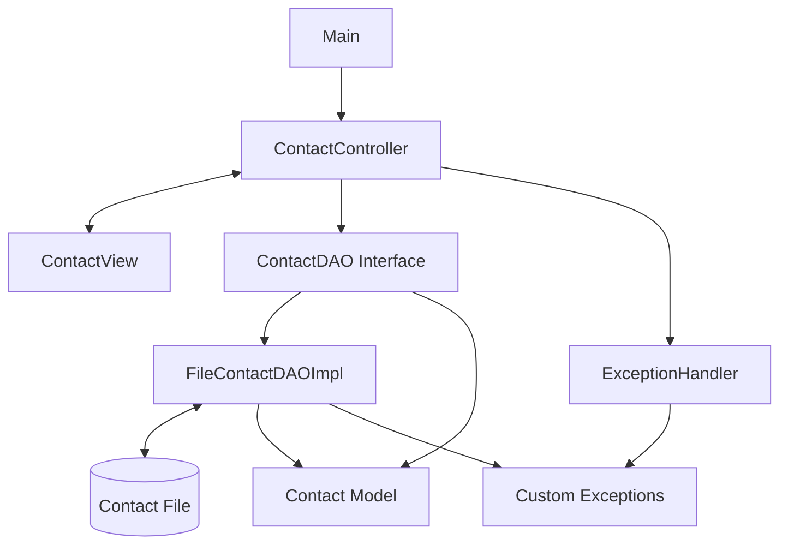

# Contact App — Architecture Diagram

This diagram shows how the different parts of our application communicate.

## Component Responsibilities

| Component | Responsibility |
|---|---|
| Main | Starts the application |
| ContactController | Coordinates application operations |
| ContactView | Displays menus and receives user input |
| ContactDAO | Defines data operations |
| FileContactDAOImpl | Reads and writes contact data |
| Contact | Represents a contact |
| ExceptionHandler | Handles application errors |
| Custom Exceptions | Represent specific application errors |

## Architecture Overview

The application follows an MVC-inspired structure.

- **Model:** Represents contact information.
- **View:** Handles interaction with the user.
- **Controller:** Connects the view and data operations.
- **Data:** Handles saving and retrieving contacts.
- **Exception:** Handles application-specific errors.

This is our initial design. The team should review and agree on it before implementation.