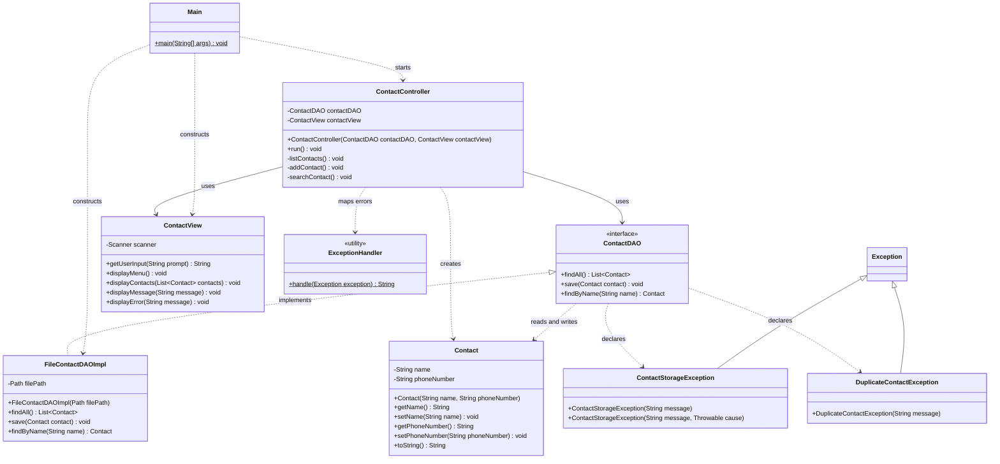

# Group 4 — Contact App: Implemented Technical Architecture

The merged application is an **MVC-inspired console program** with a data-access object (DAO), checked storage exceptions, and a centralized exception-to-message utility. This document describes the **implemented classes on `main`** after PR #17, not just the initial design proposal.

## UML class diagram



`+` public; `-` private; `$` static; dashed inheritance from `FileContactDAOImpl` is interface implementation. The text file is a persistence resource rather than a Java class.

## Responsibility boundaries

| Layer | Classes | Behavior |
|---|---|---|
| Model | `Contact` | Stores name and phone number; rejects blank name or non-ten-digit phone via `IllegalArgumentException`. |
| View | `ContactView` | Owns `Scanner`, console prompts, menu and output. |
| Controller | `ContactController` | Routes list/add/search/exit, calls DAO, recovers from expected errors, displays messages through view. |
| Data | `ContactDAO`, `FileContactDAOImpl` | Abstract persistence and implement file read/write/search without direct console I/O. |
| Errors | `ExceptionHandler`, checked exception types | Return safe user-visible messages; distinguish invalid input, duplicates, and storage errors. |
| Startup | `se.lexicon.controller.Main` | Configures relative `contacts.txt` path, constructs dependencies, invokes `run()`. |

## Method and storage contracts

| Method | Result | Failure semantics |
|---|---|---|
| `ContactDAO.findAll()` | `List<Contact>`; empty if file absent | `ContactStorageException` for unreadable/malformed storage |
| `ContactDAO.findByName(String)` | First case-insensitive match, otherwise `null` | `ContactStorageException` on underlying storage errors |
| `ContactDAO.save(Contact)` | Persists contact while preserving existing records | `DuplicateContactException` if name already exists; `ContactStorageException` for storage error |
| `Contact` constructor and setters | Validated fields | Unchecked `IllegalArgumentException` |
| `ExceptionHandler.handle(Exception)` | Readable `String` for view | No direct console output |
| `ContactController.run()` | Loops until exit/input closure | Reports recoverable errors and continues |

**Text format:** each line stores `name|phoneNumber` in `contacts.txt` relative to the process working directory. The parser finds the **last `|`**, allowing the separator inside a name while keeping a ten-digit phone. An invalid record becomes `ContactStorageException` with the record's line number and, where applicable, the original cause. The code uses try-with-resources for reading and writing and `TRUNCATE_EXISTING` when rewriting the complete list.

## Build, startup, and tests

```bash
mvn clean verify
java -cp target/classes se.lexicon.controller.Main
```

The CI environment now uses **JDK 17**, matching the Java 17 compilation target in `pom.xml` (PR #18). The earlier JDK 25 build was also successful. JUnit Jupiter 5.12.2 covers model, view, controller, contract and file DAO behaviors. The final JDK 17 run passed **52/52 tests**. An additional 11-scenario scripted console run passed **11/11** with the accepted storage fixes.

**Historical correction:** the original detailed task specification proposed `se.lexicon.Main`, but the implemented entry point is **`se.lexicon.controller.Main`**. This document describes the actual merged source and does not request a package move.

## Boundaries and evidence

The implementation is an educational application with a simple line-based file format, not a concurrent database. The code and tests do not by themselves establish that an individual developer's IntelliJ project configuration is correct. A human-operated final manual demonstration was not separately recorded.

- [Detailed original task specification](Team-task-description.md)
- [Reconciled team work plan](WORK_PLAN.md)
- [Final team report](FINAL_TEAM_REPORT.md)
- [Final GitHub Actions run](https://github.com/JayB111/contact-app-workshop/actions/runs/45141713579)
