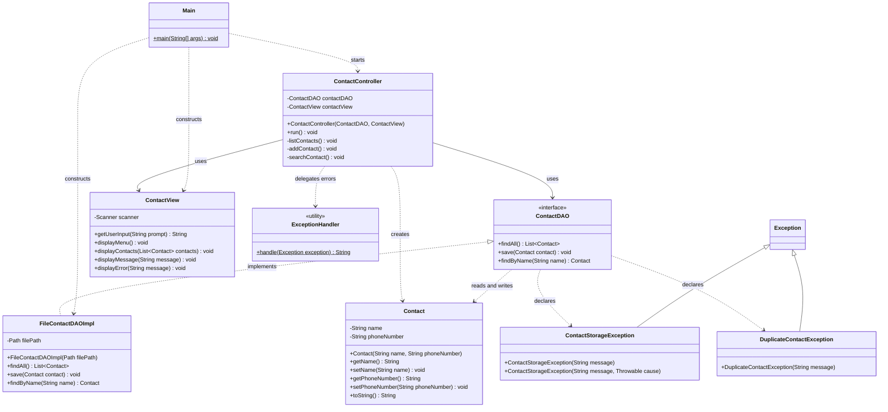

# Contact App — Technical Architecture

The workshop uses an **MVC-inspired** console application with a **DAO** for file persistence and a centralized error-to-message handler. The diagram below shows the **agreed target design**, not a claim that every class is already implemented.

## UML class diagram

`+` means public, `-` means private, `$` denotes a static method, the dashed inheritance arrow indicates that `FileContactDAOImpl` implements the `ContactDAO` interface, and the solid inheritance arrows show checked exceptions extending `Exception`. The contact text file is a persistence resource, not a Java class, so it is described below rather than shown as a UML class.

## Layer responsibilities

| Layer | Classes | Responsibility |
|---|---|---|
| Model | `Contact` | Encapsulates name and phone number; validates input with unchecked `IllegalArgumentException` |
| Data | `ContactDAO`, `FileContactDAOImpl` | Defines storage contract and implements file operations without console output |
| View | `ContactView` | Reads input and displays menu, contacts, messages, and errors |
| Controller | `ContactController` | Coordinates actions and sends exception messages through the view |
| Error handling | `ExceptionHandler`, checked exceptions | Converts errors to readable text; models duplicate and storage failures |
| Startup | `Main` | Constructs dependencies and starts `ContactController.run()` |

## Method contracts and exception flow

| Method | Return / outcome | Checked exceptions |
|---|---|---|
| `ContactDAO.findAll()` | `List<Contact>`; empty list if storage file is absent | `ContactStorageException` |
| `ContactDAO.findByName(String)` | Matching `Contact`, or `null` if absent; name comparison ignores case | `ContactStorageException` |
| `ContactDAO.save(Contact)` | Saves a contact; rejects duplicate names case-insensitively | `ContactStorageException`, `DuplicateContactException` |
| `Contact(String, String)` and setters | Validated contact; name nonblank and phone exactly 10 digits | None — `IllegalArgumentException` is unchecked |
| `ExceptionHandler.handle(Exception)` | User-readable `String` message; no console output | None |
| `ContactController.run()` | Menu loop until exit; displays recoverable errors through the view | Handled within controller |

**Storage contract:** `FileContactDAOImpl` receives a `Path` in its constructor; it uses try-with-resources for file I/O, preserves valid records, and wraps file/malformed-record failures as `ContactStorageException`. The final text-file format and default storage path still require team agreement.

**User interaction:** The current `ContactView` displays menu options `1` List, `2` Add, `3` Search, `4` Exit. Console input/output belongs to `ContactView`, not the DAO or model. `ExceptionHandler` produces messages; the controller passes them to `ContactView.displayError(...)`.

## Implementation notes

- The diagram follows the method contracts in [Team-task-description.md](Team-task-description.md). `FileContactDAOImpl`, `ContactController`, `ExceptionHandler`, and `Main` are integration work and may be placeholders in the current `main` branch; consult merged PRs for progress.
- The task specification expects `se.lexicon.Main` (`src/main/java/se/lexicon/Main.java`), but the current repository has a placeholder `se.lexicon.controller.Main`. The team should choose the final package; no Java file is moved by this documentation change.
- GitHub Actions runs Maven verification on JDK 25 while the current `pom.xml` targets Java 17 source/bytecode compatibility. This is intentional documentation of the current configuration, not a change to the build.
- The diagram covers application classes only. Unit tests validate model, controller, and exception behaviour separately and are not shown as additional UML classes.
